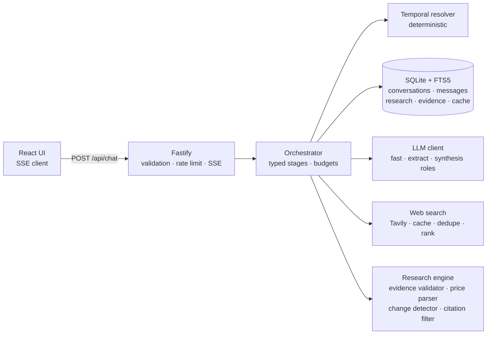

# Minimi Research Agent

A conversational research agent with **one tool: web search**. It remembers your past conversations, works out which one you mean ("last Tuesday", "on 3 November"), checks the web for what's changed since, and answers with citations. When it can't verify something, it says so.

> Built for the minimi Software Engineering Internship challenge. Design rationale: [DESIGN.md](DESIGN.md).

```
You:   Last Tuesday I asked you about Postgres hosting. Has any pricing changed since then?
Agent: The only pricing shift since Tuesday 10 Nov is Neon Launch, which moved from a flat
       $19/month to usage-based pricing ($0.106 per CU-hour) [12]. Supabase Pro, Render
       Basic-1gb, AWS RDS db.t4g.micro and Railway Hobby are unchanged [4][1][10][2].

       ┌ Pricing then vs. now ────────────────────────────────────────────────────────┐
       │ Neon · Launch       $19 per month      $0.106/CU-hour      Not comparable    │
       │ Supabase · Pro      $25/month per org  $25/org/month       Unchanged         │
       │ Render · Basic-1gb  $19 per month      $19/month           Unchanged         │
       │ …                                                                            │
       └──────────────────────────────────────────────────────────────────────────────┘
```
*(From an actual live run; see [evals/LIVE_REPORT.md](evals/LIVE_REPORT.md).)*

## Quick start

Requirements: **Node.js ≥ 22.13** (uses the built-in `node:sqlite`; nothing native to compile).

```bash
cp .env.example .env      # add GROQ_API_KEY and TAVILY_API_KEY (both have free tiers)
npm install
npm run dev               # web on http://localhost:5173, API on http://127.0.0.1:8787
```

On first start the database is created at `data/minimi.db` and seeded with **clearly labeled demo conversations**, so the three challenge prompts work immediately. Seed dates are relative to the day you first start the app ("Monday" = the most recent Monday). If you come back on a later day, run `npm run seed:reset` to move them. Each prompt is one click on the empty-chat screen. Seeded items carry a violet "seeded demo" badge, and the agent says when it's drawing on seeded data.

| Key | Where | Needed for |
|---|---|---|
| `GROQ_API_KEY` | https://console.groq.com/keys | default LLM provider (free tier) |
| `TAVILY_API_KEY` | https://app.tavily.com | the web search tool (free tier, 1,000 credits/month) |
| `ANTHROPIC_API_KEY` | https://console.anthropic.com | optional: `LLM_PROVIDER=anthropic` or `LLM_SYNTHESIS_PROVIDER=anthropic` |

Without keys the app still starts; `/api/health` and a banner in the UI name what's missing.

## Commands

| Command | What it does |
|---|---|
| `npm run dev` | API (tsx watch) + web (Vite, proxies `/api`) |
| `npm run build` | typecheck → Vite build → bundle the API to `apps/api/dist` |
| `npm start` | production mode: one server on `:8787` serving API + built UI |
| `npm test` | Vitest: unit + integration (Fastify inject), no network |
| `npm run eval` | offline evaluation: 49 deterministic scenarios → [evals/REPORT.md](evals/REPORT.md) |
| `npm run eval:live` | live evaluation against real Groq + Tavily → [evals/LIVE_REPORT.md](evals/LIVE_REPORT.md) |
| `npm run lint` / `npm run typecheck` | ESLint / tsc (strict) |
| `npm run seed:reset` | re-seed demo conversations with dates relative to today |

## Architecture



```
apps/api        Fastify server: routes (health, conversations, chat SSE), error handling
apps/web        React + Vite + Tailwind: sidebar, streaming chat, comparison table, sources
packages/core   all agent logic, framework-free and unit-testable
  agent/        orchestrator, prompts (versioned), context assembly, citation filters, heuristics
  temporal/     date-expression resolver (Luxon, timezone-aware, ambiguity-aware)
  memory/       hybrid retrieval: date filter + FTS5 bm25 + topical score + exchange expansion
  llm/          provider interface; Groq/OpenAI-compatible + Anthropic adapters; Zod-validated JSON
  search/       Tavily adapter, URL normalisation, de-duplication, source ranking, SQLite cache
  research/     plan finalisation, evidence validation, price parsing, change detection
  db/           node:sqlite connection, versioned migrations, typed repositories
  seed/         labelled demo conversations (dates relative to today)
  testing/      deterministic test doubles (scripted LLM, fixture search) used by tests/evals only
evals/          offline scenarios + runner, live runner, fixtures, reports
tests/          unit + integration tests
```

Per message the orchestrator runs: **validate → resolve dates → analyze → recall memory → plan → search → extract evidence → verify → compare → stream answer → validate citations → persist**. Each stage emits progress over SSE (the UI shows it live), has a budget, and degrades gracefully: a failed search, invalid model JSON or missing key yields a qualified answer, not a crash. Details and trade-offs are in [DESIGN.md](DESIGN.md) and [docs/architecture.md](docs/architecture.md).

## How it stays honest

- **Memory:** it only "remembers" conversations that retrieval actually returned. Historical claims are kept only if their text appears in a retrieved message.
- **Evidence:** every extracted fact must carry a quote that occurs in the cited search result. URLs, titles and dates come from the search API, never the model.
- **Verdicts:** "changed / unchanged / uncertain / not comparable" is computed by code. Per-seat vs. total, flat vs. usage-based, monthly vs. annual, missing plans and conflicting sources never produce "changed". No evidence means "uncertain", never "unchanged".
- **Citations:** `[S#]` references to unknown sources and URLs that weren't retrieved are removed while streaming.
- **Untrusted web content:** results containing instructions aimed at AI systems are quarantined; source text is delimited as data in prompts.
- **No fake confidence numbers:** the UI shows qualitative statuses and source type (official pricing / official / news / third-party).

## Testing and evaluation

- `npm test`: 117 tests covering temporal parsing, retrieval, ranking, price parsing, change detection, evidence and citation validation, and full pipeline and HTTP/SSE runs with deterministic doubles.
- `npm run eval`: 49 scenarios (temporal, memory, web research, pricing, product updates, multi-turn, uncertainty, adversarial, and the 3 official demos). Last run: 49/49. These check the deterministic machinery given known model outputs; they don't measure model quality.
- `npm run eval:live`: the 3 official prompts plus 2 controls against real Groq + Tavily. Last run: 5/5 pass the automatic grounding checks, about 10–25 s per research question when run alone (search is the largest stage), about 12–14K tokens per research question. Price correctness still needs a human to open the cited sources; the report lists them.

See [docs/evaluation.md](docs/evaluation.md) for metrics, adversarial cases, and bugs found by live testing.

## Known limitations

- Prices rendered only by JavaScript on vendor pages often don't appear in search snippets, so those rows end up "uncertain".
- Groq's free tier allows about 8K tokens per minute per model; back-to-back research questions can wait 20–40s for the limit to reset.
- Seeded demo prices are best-effort public prices, so a "changed" verdict can reflect seed inaccuracy rather than a real change.
- Single-user local app: no authentication; one SQLite file.

## License

MIT, see [LICENSE](LICENSE).
