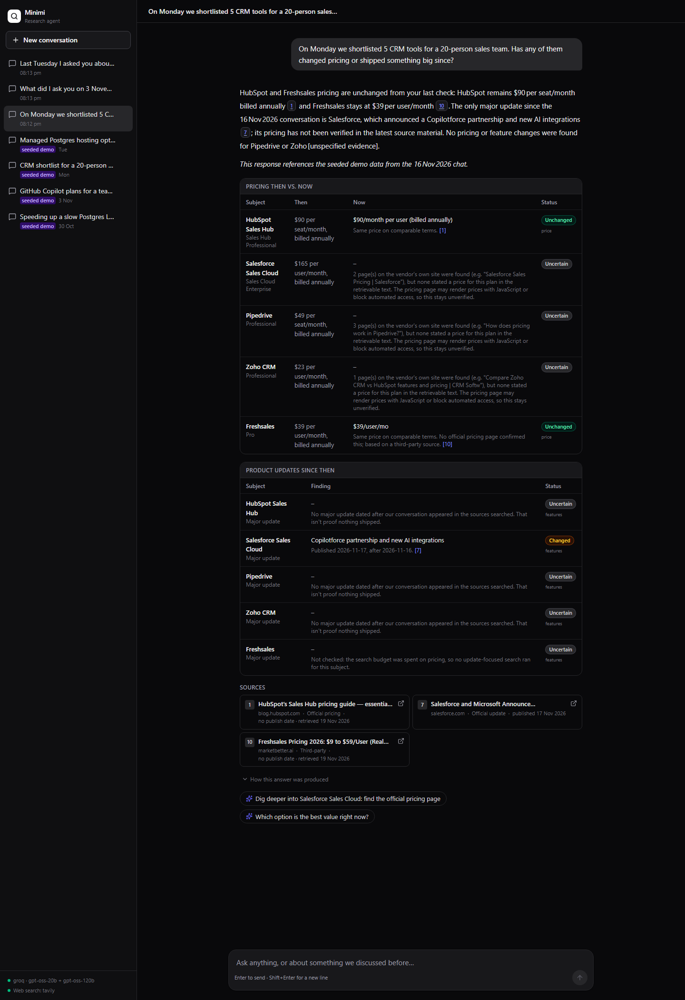
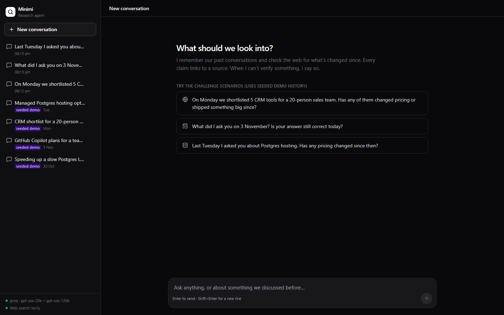
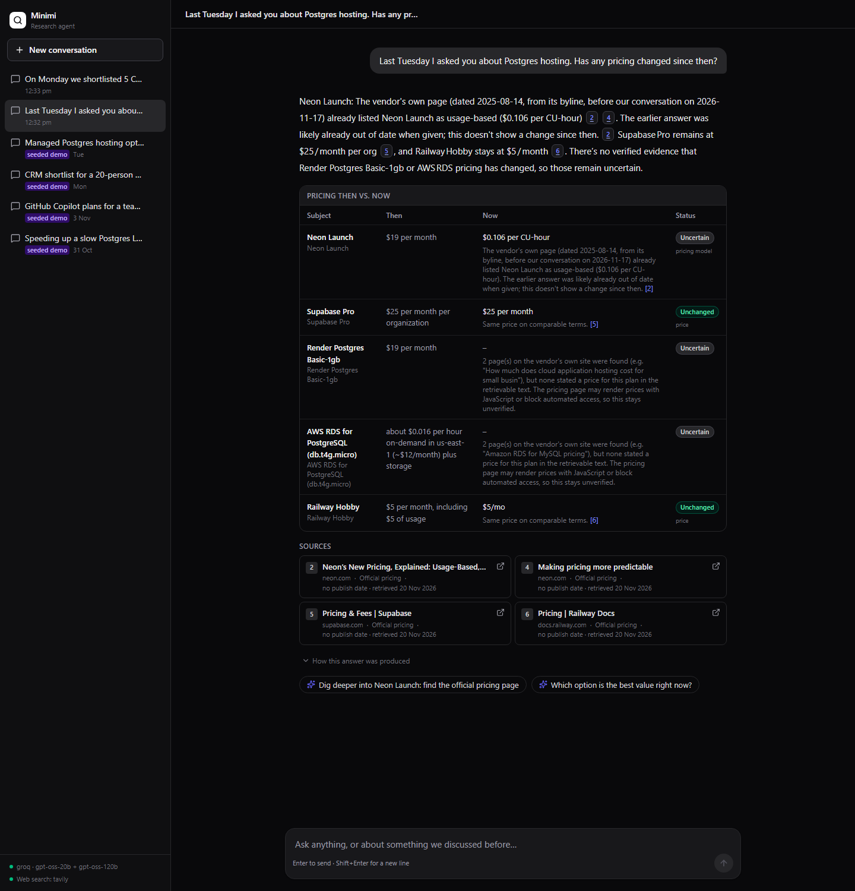
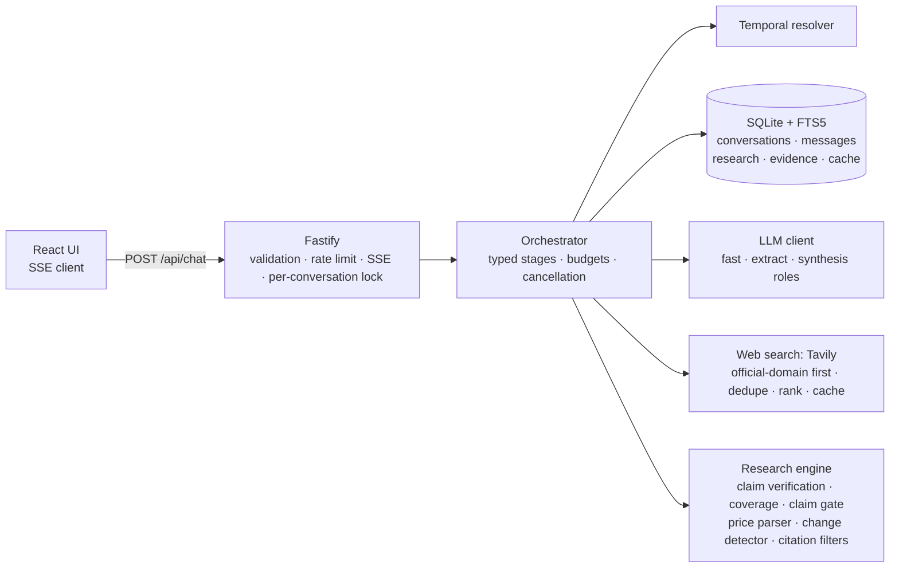

# Minimi Research Agent

A chat agent with **one tool: web search**. Ask it anything current and it searches, checks what the sources cover, searches again for what's missing, and answers with citations whose figures are checked against the cited pages. Ask about an earlier conversation ("last Tuesday", "on 3 November") and it finds that conversation, re-checks the vendors' own pages for what has changed since, and says plainly what it could not verify.

Built for the minimi Software Engineering Internship challenge. Design rationale (one page): [DESIGN.md](DESIGN.md).



## Quick start

Requires **Node.js ≥ 22.13** (built-in `node:sqlite`, so nothing native to compile).

```bash
cp .env.example .env      # add GROQ_API_KEY and TAVILY_API_KEY (both have free tiers)
npm install
npm run dev               # UI http://localhost:5173 · API http://127.0.0.1:8787
```

| Key | Get it at | Used for |
|---|---|---|
| `GROQ_API_KEY` | console.groq.com/keys | default LLM provider (free tier) |
| `TAVILY_API_KEY` | app.tavily.com | the web-search tool (free tier: 1,000 credits/month) |
| `ANTHROPIC_API_KEY` | console.anthropic.com | optional: `LLM_PROVIDER=anthropic`, or Claude for the answer only via `LLM_SYNTHESIS_PROVIDER=anthropic` |

For the best prose, add `ANTHROPIC_API_KEY` and set `LLM_SYNTHESIS_PROVIDER=anthropic`: Groq keeps the fast structured stages, and Claude writes the answers.

The app starts without keys; the UI banner and `/api/health` say what's missing. On first start the database (`data/minimi.db`) is seeded with **labeled demo conversations** dated relative to today, so the three challenge prompts work immediately. They are one click away on the empty-chat screen. Seeded items carry a violet "seeded demo" badge. On a later day, run `npm run seed:reset` to re-date them.

## Six intents, four pipelines, decided in code

| Intent | Example | Pipeline | What runs |
|---|---|---|---|
| chat | "What can you help with?" | chat | one streamed answer |
| fact_lookup | "Latest Node.js LTS?" | lookup | 1–3 concurrent searches → coverage check (+ targeted follow-up for gaps) → answer over excerpts → claim gate |
| general_research | "Research Vercel's recent launches" | research | searches → claims extracted with verbatim quotes, verified in code → entities × aspects coverage → one targeted follow-up round for gaps → answer → claim gate |
| comparison | "Cursor vs Copilot vs Windsurf: features, pricing model, privacy" | research | as above, every option searched, same criteria per option, gaps shown as "not found" |
| historical_audit | "What did I ask you on 3 November? Still correct?" | deep | memory → plan → search → evidence → comparison → answer, guard and claim gate |
| pricing_diff | "Has any pricing changed since last Tuesday?" | deep | the verified pricing pipeline: vendor-first search, plan-attributed quotes, deterministic comparison, timing, guard, required findings |

The model proposes the intent; code decides (`chooseIntent` in [heuristics.ts](packages/core/src/agent/heuristics.ts)). A reference to an earlier conversation never skips memory, and a price check never skips the pricing verifier. Every lookup and research answer, and every non-pricing audit, passes a **claim gate**: each sentence (or table cell) is shown only after every figure, date and version in it is found in a source it cites. Otherwise it is re-cited to the source that has it, or removed ("not verified" in a table). Under each answer the UI shows, rendered from code rather than prose, what the sources covered, what they didn't, where they disagree, and how many statements were checked.

## Test memory with your own history

The seeded demo conversations make the challenge prompts work on first start. To test recall on your own history, import a conversation with its original timestamps: use **Import past conversation** in the sidebar, or call the API:

```bash
curl -X POST localhost:8787/api/conversations/import -H 'content-type: application/json' -d @docs/import-example.json
```

The format is in [docs/import-example.json](docs/import-example.json): `title?`, `timezone?`, and `messages[]` with `role`, `content` and an ISO `createdAt`, in chronological order and not in the future. Imported conversations are indexed and recalled exactly like live ones ("What did I ask you last Tuesday?"), and are labelled "imported" in the sidebar.

## The three challenge scenarios

| Prompt | What the agent does |
|---|---|
| *On Monday we shortlisted 5 CRM tools for a 20-person sales team. Has any of them changed pricing or shipped something big since?* | Resolves "Monday" to a date and recovers all five tools and their quoted plans. It searches each vendor's own pricing page first, then the open web, and runs a dated news search per vendor for launches. Then it compares plan by plan. |
| *What did I ask you on 3 November? Is your answer still correct today?* | Retrieves that day's question and answer, extracts the claims it made (Copilot plan prices), and re-checks each against current official pages. Because the user asked "still correct?", it also checks for product updates. |
| *Last Tuesday I asked you about Postgres hosting. Has any pricing changed since then?* | Resolves "last Tuesday" (ambiguous on some weekdays: it picks the candidate whose conversation matches the topic and says so) and compares each provider. A switch from a flat plan to usage-based pricing is reported as a **pricing-model change**, not an amount change. |






Screenshots are from the app against live Groq + Tavily on 2026-11-20, taken on the earlier 83a5d11 snapshot. They show the challenge prompts, which run on the deep pipeline; the research-coverage panel added later appears only on lookup and research answers. Live output varies between runs.

Every row in the table carries a **status** (changed / unchanged / uncertain / not comparable) and the **dimension** it concerns (price, pricing model, billing terms, currency, plan availability, features). Sources show whether they are the vendor's own page or third-party, plus their publish date (or "no publish date").

## Architecture



`validate → resolve dates → analyze → chooseIntent → pipeline → persist`, with four pipelines:

- **chat:** `answer`.
- **lookup:** `search (open, + official-domain when known) → rank/screen → coverage → [targeted follow-up] → answer → claim gate`.
- **research:** `search → claim extraction (quotes verified in code) → coverage → [targeted follow-up] → answer → claim gate`.
- **deep:** `recall memory → plan → vendor-first search → extract evidence → verify → compare → answer → guard + required findings` (plus the claim gate for non-pricing audits).

Each stage reports progress over SSE (the UI shows it live) and runs within a budget. The pipeline handles missing credentials, invalid structured output and provider failures (including exhausted model or search quotas) with explicit errors or qualified partial answers, rather than silently presenting unverified facts.

```
apps/api        Fastify routes: health, conversations, chat (SSE)
apps/web        React + Vite + Tailwind UI
packages/core   all agent logic (framework-free, unit-tested)
  agent/        orchestrator, intent routing, versioned prompts, context assembly,
                citation filters, claim gate, answer guard, required findings
  temporal/     date resolver   memory/  hybrid retrieval, history import   llm/  provider adapters
  search/       Tavily, normalisation, ranking, cache
  research/     general evidence + coverage, pricing evidence, prices, comparison
  db/           node:sqlite, migrations, repositories   testing/  deterministic test doubles
evals/          offline scenarios, live runner, grading, ground truth, reports
```

## Key technical decisions

- **Typed intents, decided in code.** Six intents map to four pipelines, so a fact lookup doesn't pay for a pricing audit, and a pricing audit can't be skipped.
- **Bounded adaptive research, not an open agent loop.** Search, assess coverage (entities × aspects), run one targeted follow-up per gap, stop. At most two rounds, never a repeated query, ≤ 8 LLM calls and ≤ 10 searches per message, deterministic tests.
- **One general evidence model.** Claims carry verbatim supporting quotes, source authority (official / primary / secondary) and confidence, all verified or computed in code. The pricing pipeline keeps its stricter, specialised model.
- **Validate structure, not just prose.** The claim gate checks every figure against its citation before display. Required findings make sure no computed change or possible update is omitted. Coverage and disagreements are rendered from metadata. No new pricing-specific text rules were added.
- **The model reads; code decides.** Extracted facts need a verbatim quote found in the source, a source that names the vendor, and a price tied to the named plan. Verdicts are computed by a tested price parser and comparator, never by the model.
- **Official sources first.** Pricing searches target the vendor's domain (Tavily `include_domains`), with an open search if those pages show no visible prices or budget remains. Lookup and research run one query restricted to the official domains the analysis names (vetted in code) and drop pages for a different major version than the one asked about. Third-party verdicts are labeled as such.
- **Honest uncertainty.** No evidence, conflicting sources, stale pages, pages published before the conversation, or prices not tied to the plan all yield "uncertain". "Not comparable" never means "unchanged".
- **No native dependencies.** Built-in `node:sqlite` (FTS5) instead of better-sqlite3: unsigned native binaries were blocked on the development machine.
- **Free-tier aware.** Groq quotas are per model, so roles are split across two models, with escalation (planning) and fallback (extraction on rate limit). Chat, lookup and research answers stream on the larger model (idle on those paths, with its own quota) and fall back to the smaller one if it is rate-limited. The Anthropic adapter is validated against the real API (structured output and streaming).
- **Three separate questions.** Was the earlier claim right when made (`historicalAccuracy`), has it changed since (status + dimension), and is the earlier answer incomplete (plans on vendor pages it never mentioned, shown as "also offered now", never called new without a dated source).

## Testing and evaluation

| Command | What it checks | Last result |
|---|---|---|
| `npm test` | 282 unit + integration tests (Fastify inject, deterministic doubles, no network): routing, research loop, claim gate, coverage, required findings, import, pricing pipeline | 282/282 |
| `npm run eval` | 64 deterministic scenarios: dates, memory, research, pricing, completeness, updates, multi-turn, uncertainty, adversarial, general research (lookup, comparison, gap follow-up, sources that differ, claim gate, required findings), the 3 demos. Report: [evals/REPORT.md](evals/REPORT.md) | 64/64 |
| `npm run eval:live` | 28 cases against real Groq + Tavily: the 3 challenge prompts, 2 controls, memory on imported history, and 22 general-research cases (current facts, technical research, company launches, comparisons, current developments, conflicting sources, source quality, 5-dimension completeness, follow-up context, injected instructions, abstention). Automatic checks, general-research metrics (coverage, gap disclosure, citation precision, source authority, routing, abstention, latency by pipeline) and ground-truth grading for the challenge prompts. General answers were reviewed by the project author against their sources (2026-11-21). Report: [evals/LIVE_REPORT.md](evals/LIVE_REPORT.md) | **Full run (12:50 UTC): 21/28**; challenge prompts 8 correct / 1 abstained / **0 wrong** against human-confirmed ground truth. The 7 failures were diagnosed: 5 agent fixes and 2 checker corrections (disclosed); all 7 passed on targeted re-runs. [Details](evals/LIVE_REPORT.md#after-the-full-run-diagnosis-fixes-and-targeted-re-runs-2026-11-20-same-day) |
| `npm run eval:perf` | searches, LLM calls, tokens and per-stage latency computed from saved live runs (no API calls) | see [docs/evaluation.md](docs/evaluation.md) |
| `npm run lint` · `npm run typecheck` · `npm run build` | ESLint, strict tsc, production build | clean |

CI ([.github/workflows/ci.yml](.github/workflows/ci.yml)) runs a clean `npm ci`, typecheck, lint, tests, offline evaluation and build on Ubuntu (Node 22 and 24) and Windows (Node 24).

Offline scenarios test the deterministic machinery against known model outputs. They don't measure live model quality; the live suite does. Live evidence comes in three kinds, kept separate. Automatic checks judge behaviour. Ground truth for the challenge prompts was taken from official pages and **human-confirmed on 2026-11-20** (the project author opened each page); Render, AWS RDS, Pipedrive and Zoho stay ungraded rather than guessed. General-research answers are measured by automatic metrics, and their factual correctness was **reviewed by the project author** against the cited sources (2026-11-21); the two errors that review found are listed in [docs/evaluation.md](docs/evaluation.md#limitations-of-the-evaluation). In the deep pipeline, a code-level answer guard enforces the facts that live runs showed the model dropping or contradicting. Other wording is still the model's. Evaluation details, limitations and snapshot verification: [docs/evaluation.md](docs/evaluation.md).

## Known limitations

- Vendor pages that render prices with JavaScript, and sites that block fetchers, give "uncertain" rows.
- Groq's free tier has per-model quotas (8K tokens/min and a daily token cap). Heavy use falls back to the smaller model, with a note in the answer; about nine full live-eval runs in a day exhausted it on 2026-11-20.
- Live results vary between runs because search results and model outputs vary.
- The claim gate checks figures, dates and versions against cited sources, not meaning: a sentence without figures passes on its (valid) citation alone.
- The comparison table is computed in code and the answer guard enforces specific facts. Beyond those, the prose is the model's and can still drop a qualifier.
- Vendor pricing pages are rarely dated. When no self-dated vendor page is found, a difference is reported as "timing unknown", not as a change since the conversation.
- The free search tier (Tavily, 1,000 credits/month) limits live runs; once it's exhausted, searches fail with HTTP 432 and answers say nothing could be checked.
- Seed prices are best-effort demo data, so a "changed" verdict can reflect seed inaccuracy.
- Single user, single SQLite file, no authentication.

`npm start` serves the built UI and API on one port after `npm run build`. Licensed under MIT.
