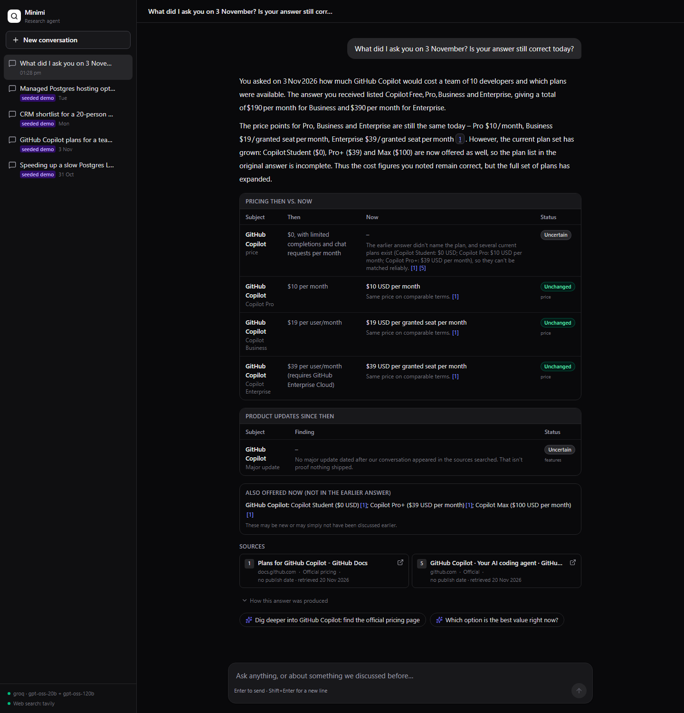
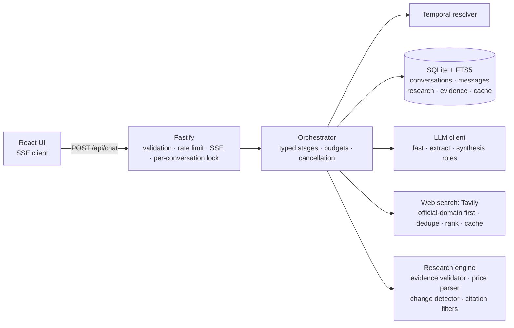

# Minimi Research Agent

A chat agent with **one tool: web search**. It remembers past conversations, works out which one you mean ("last Tuesday", "on 3 November"), checks the vendors' own pages for what has changed since, and says plainly what it could not verify.

Built for the minimi Software Engineering Internship challenge. Design rationale (one page): [DESIGN.md](DESIGN.md).


## Quick start

Requires **Node.js ≥ 22.13** (built-in `node:sqlite`, so nothing native to compile).

```bash
cp .env.example .env      # add GROQ_API_KEY and TAVILY_API_KEY (both have free tiers)
npm install
npm run dev               # UI http://localhost:5173 · API http://127.0.0.1:8787
```

| Key | Get it at | Used for |
|---|---|---|
| `GROQ_API_KEY` | console.groq.com/keys | default LLM provider (free tier) |
| `TAVILY_API_KEY` | app.tavily.com | the web-search tool (free tier: 1,000 credits/month) |
| `ANTHROPIC_API_KEY` | console.anthropic.com | optional: `LLM_PROVIDER=anthropic`, or Claude for the answer only via `LLM_SYNTHESIS_PROVIDER=anthropic` |

The app starts without keys; the UI banner and `/api/health` say what's missing. On first start the database (`data/minimi.db`) is seeded with **labeled demo conversations** dated relative to today, so the three challenge prompts work immediately. They are one click away on the empty-chat screen. Seeded items carry a violet "seeded demo" badge. On a later day, run `npm run seed:reset` to re-date them.

## The three challenge scenarios

| Prompt | What the agent does |
|---|---|
| *On Monday we shortlisted 5 CRM tools for a 20-person sales team. Has any of them changed pricing or shipped something big since?* | Resolves "Monday" to a date and recovers all five tools and their quoted plans. It searches each vendor's own pricing page first, then the open web, and runs a dated news search per vendor for launches. Then it compares plan by plan. |
| *What did I ask you on 3 November? Is your answer still correct today?* | Retrieves that day's question and answer, extracts the claims it made (Copilot plan prices), and re-checks each against current official pages. Because the user asked "still correct?", it also checks for product updates. |
| *Last Tuesday I asked you about Postgres hosting. Has any pricing changed since then?* | Resolves "last Tuesday" (ambiguous on some weekdays: it picks the candidate whose conversation matches the topic and says so) and compares each provider. A switch from a flat plan to usage-based pricing is reported as a **pricing-model change**, not an amount change. |




Screenshots are from the app against live Groq + Tavily on 2026-11-20 (3 November on the final commit). Live output varies between runs.

Every row in the table carries a **status** (changed / unchanged / uncertain / not comparable) and the **dimension** it concerns (price, pricing model, billing terms, currency, plan availability, features). Sources show whether they are the vendor's own page or third-party, plus their publish date (or "no publish date").

## Architecture



`validate → resolve dates → analyze → recall memory → plan → search → extract evidence → verify → compare → stream answer → filter/repair citations → persist`. Each stage reports progress over SSE (the UI shows it live) and runs within a budget. The pipeline handles missing credentials, invalid structured output and provider failures (including exhausted model or search quotas) with explicit errors or qualified partial answers, rather than silently presenting unverified facts.

```
apps/api        Fastify routes: health, conversations, chat (SSE)
apps/web        React + Vite + Tailwind UI
packages/core   all agent logic (framework-free, unit-tested)
  agent/        orchestrator, versioned prompts, context assembly, citation filters
  temporal/     date resolver   memory/  hybrid retrieval   llm/  provider adapters
  search/       Tavily, normalisation, ranking, cache   research/  evidence, prices, comparison
  db/           node:sqlite, migrations, repositories   testing/  deterministic test doubles
evals/          offline scenarios, live runner, grading, ground truth, reports
```

## Key technical decisions

- **One orchestrated pipeline, not an agent loop.** Bounded cost (≤ 8 LLM calls, ≤ 10 searches per message) and deterministic tests.
- **The model reads; code decides.** Extracted facts need a verbatim quote found in the source, a source that names the vendor, and a price tied to the named plan. Verdicts are computed by a tested price parser and comparator, never by the model.
- **Official sources first.** Pricing searches target the vendor's domain (Tavily `include_domains`). If those pages show no visible prices, or budget remains, an open search runs too. Third-party verdicts are labeled as such.
- **Honest uncertainty.** No evidence, conflicting sources, stale pages, pages published before the conversation, or prices not tied to the plan all yield "uncertain". "Not comparable" never means "unchanged".
- **No native dependencies.** Built-in `node:sqlite` (FTS5) instead of better-sqlite3: unsigned native binaries were blocked on the development machine.
- **Free-tier aware.** Groq quotas are per model, so roles are split across two models, with escalation (planning) and fallback (extraction on rate limit). The Anthropic adapter is validated against the real API (structured output and streaming).
- **Three separate questions.** Was the earlier claim right when made (`historicalAccuracy`), has it changed since (status + dimension), and is the earlier answer incomplete (plans on vendor pages it never mentioned, shown as "also offered now", never called new without a dated source).

## Testing and evaluation

| Command | What it checks | Last result |
|---|---|---|
| `npm test` | 226 unit + integration tests (Fastify inject, deterministic doubles, no network) | 226/226 |
| `npm run eval` | 54 deterministic scenarios: dates, memory, research, pricing, completeness, updates, multi-turn, uncertainty, adversarial, the 3 demos. Report: [evals/REPORT.md](evals/REPORT.md) | 54/54 |
| `npm run eval:live` | the 3 demos + 2 controls against real Groq + Tavily. Structural + product-update checks, completeness grading, and verdict grading against [human-reviewable ground truth](evals/ground-truth.json). Report: [evals/LIVE_REPORT.md](evals/LIVE_REPORT.md) | **Final commit:** full five-case run passed 5/5 automatic checks, 9 correct / 0 abstained / 0 wrong against human-confirmed ground truth; the Cursor control was complete. Separately, nine earlier complete runs during iterative development (06:30–07:06), each on the code as it stood while fixes were being made, not nine runs of an identical final build: 77 correct, 4 abstained, 0 wrong in aggregate, graded at the time against then-provisional ground truth. Only the final-commit run reflects the final build. [Details](docs/evaluation.md#live-validation-2026-11-20) |
| `npm run eval:perf` | searches, LLM calls, tokens and per-stage latency computed from saved live runs (no API calls) | see [docs/evaluation.md](docs/evaluation.md) |
| `npm run lint` · `npm run typecheck` · `npm run build` | ESLint, strict tsc, production build | clean |

CI ([.github/workflows/ci.yml](.github/workflows/ci.yml)) runs a clean `npm ci`, typecheck, lint, tests, offline evaluation and build on Ubuntu (Node 22 and 24) and Windows (Node 24).

Offline scenarios test the deterministic machinery against known model outputs. They don't measure live model quality. The live suite does, graded against ground truth taken from official pages. **Every graded entry was human-confirmed on 2026-11-20** (the project author opened each page); vendors whose prices can't be retrieved (Render, AWS RDS, Pipedrive, Zoho) stay ungraded rather than guessed. Automatic checks don't judge answer prose. A code-level answer guard enforces the facts that live runs showed the model dropping or contradicting: "not checked" vs "none found", unverified prices called unchanged, launches no dated row supports, when a change happened, "not comparable" presented as a change, legacy plans, and prices that appear in no source. Other wording is still the model's.

## Known limitations

- Vendor pages that render prices with JavaScript, and sites that block fetchers, give "uncertain" rows.
- Groq's free tier has per-model quotas (8K tokens/min and a daily token cap). Heavy use falls back to the smaller model, with a note in the answer; about nine full live-eval runs in a day exhausted it on 2026-11-20.
- Live results vary between runs because search results and model outputs vary.
- The comparison table is computed in code and the answer guard enforces specific facts. Beyond those, the prose is the model's and can still drop a qualifier.
- Vendor pricing pages are rarely dated. When no self-dated vendor page is found, a difference is reported as "timing unknown", not as a change since the conversation.
- The free search tier (Tavily, 1,000 credits/month) limits live runs; once it's exhausted, searches fail with HTTP 432 and answers say nothing could be checked.
- Seed prices are best-effort demo data, so a "changed" verdict can reflect seed inaccuracy.
- Single user, single SQLite file, no authentication.

`npm start` serves the built UI and API on one port after `npm run build`. Licensed under MIT.
